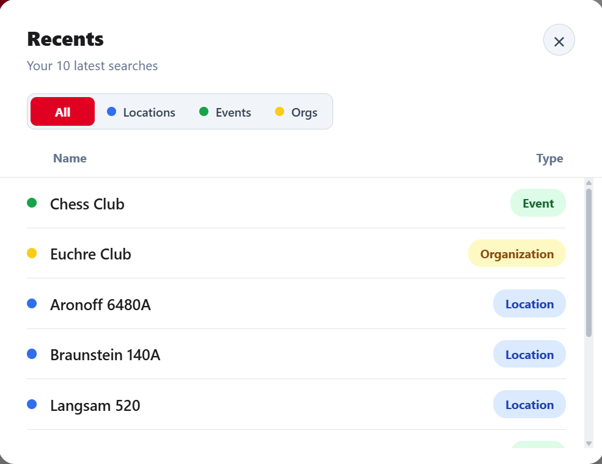
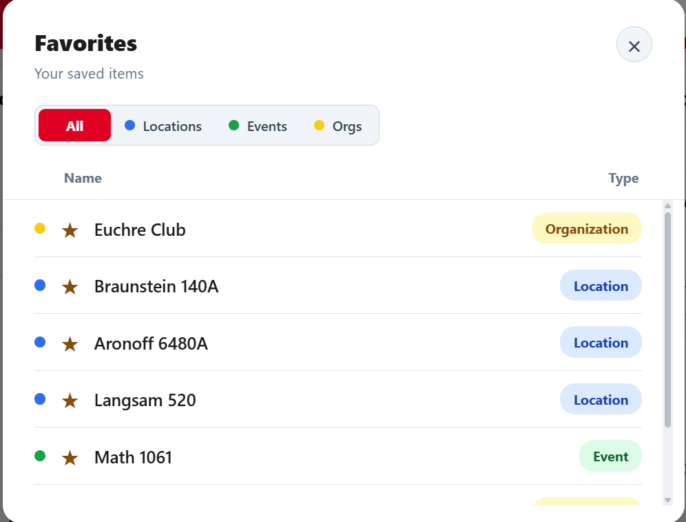
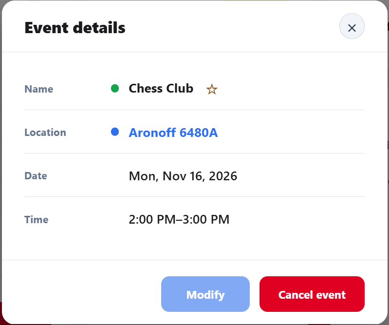
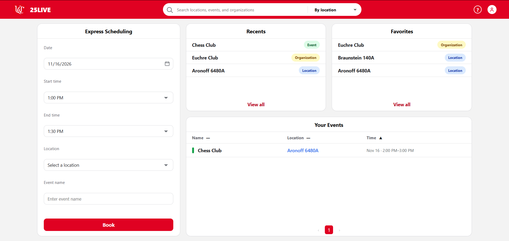
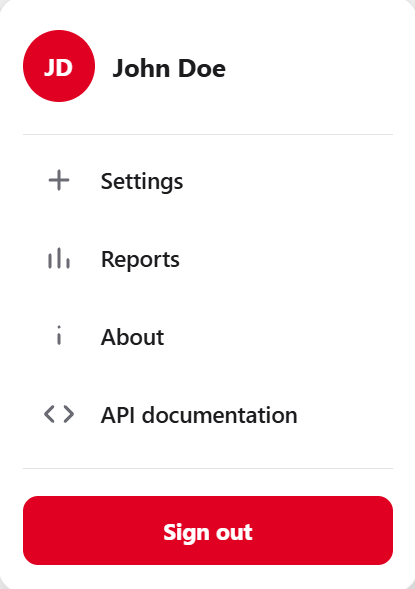
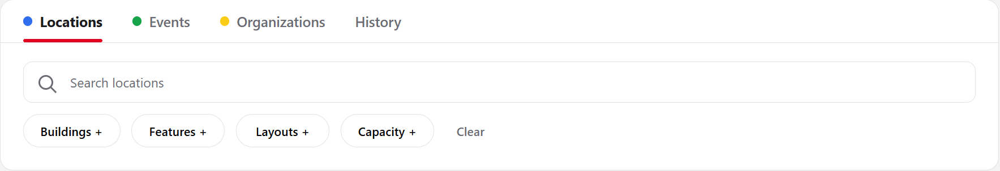
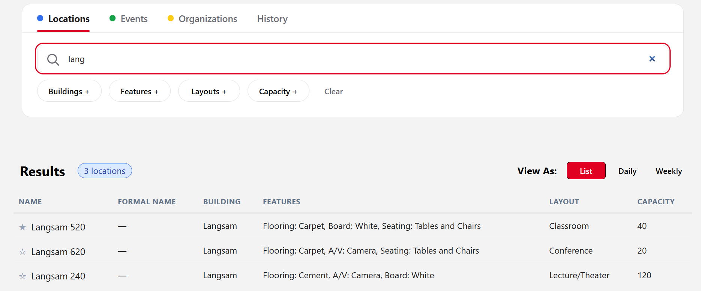

# Implementation

## Table of Contents

- [Overview](#overview)
- [Tier Based User Experience](#tier-based-user-experience)
- [Dashboard Redesign](#dashboard-redesign)
- [Menu Redesign](#menu-redesign)
- [Search Experience Rework](#search-experience-rework)
- [Event Management](#event-management)
- [Future Work](#future-work)

## Overview

The purpose of this document is to describe the implementation decisions made to produce a working prototype of the new 25Live website. These decisions cover the following:
- Tier based user experience
- Dashboard redesign
- Menu redesign
- Search experience rework
- Event Management
- Future Implementation

## Svelte Architecture

The software architecture of the new 25Live prototype is built using Svelte, JavaScript, HTML, and CSS. The primary `App` component controls navigation between the `Dashboard` and `Search` components. All components under the `./src/lib/` directory are child components to control the various features within the site.

## Tier Based User Experience

As a recap from the redesign decisions, the new tier based user experience provides a feature set specific to a user's involvement in UC's organizations. For our initial prototype, we chose to implement Tier 1 for a user with no organizational involvement. Features such as a `Your Organizations` quick view and organization admin features are hidden. 

## Dashboard Redesign

To begin our redesign implementation, we decided that the `Express Scheduling` feature should be highly emphasized to any user who accesses this site. Our observational interviews highlighted the fact that most users will revert to using the `Express Scheduling` feature when all other methods failed. 

Secondly, the original design failed to provide users with quick information about items specific to him/her. To solve this problem, users can now view his/her events in the `Your Events` box along with recently viewed items in `Recents` and a user's favorite items in `Favorites`. These new quick view features are meant to further personalize the user experience of 25Live and replace the outdated customization features. Pop up windows for each of these boxes are also available to view extended details of an event, favorite item, or recent item.

    </img>
    </img>
    </img>

Previously, searching 25Live meant the user had to chose if he/she wanted to `Quick Search`, select 1 of the 4 options in the `Menu` dropdown, or select the `Search` button. To simplify this effort, a `Search` bar was added to the top of the Dashboard ribbon and all other methods were removed. Users can now use the search bar to search by `Location`, `Event`, or `Organization`.

    </img>

## Menu Redesign

The new 25Live menu consists of 5 simple options:
- **Settings**: Combines the previous `User Settings` and `System Settings` into one button
- **Reports**: Combines the redundant `25Live Reports` and `Reports` buttons into one option
- **About**: Combines all previous `About` options into one button to host them all on one screen
- **API Documentation**: Kept the previous API Documentation button
- **Sign Out (New Feature)**: Users can now perform a sign out action

    </img>

Removed:
- All search options
- Repetitive `Home: 25Live` and `Event Form` options that are already present in the dashboard ribbon
- Menu dropdowns

As of 11/16/2026, the new Menu options do nothing. They are only there to highlight the redesign decisions.

## Search Experience Rework

The Search Experience of 25Live was completely rebuilt to simplify the various filtering options and category filters. Let's first begin by exploring how a user can perform a search query. From the `Dashboard`, a user can use the new `Search Bar` to perform a search from the following categories:
- Locations
- Events
- Organizations
The user may also select the magnifying glass icon to proceed immediately to the new Search screen. 

Upon entering the search screen, the user is presented with two sections. One section allows the user to perform the same search query in one of the three categories and select various filters according to that category. The following table describes the various categories according to their filters and viewable results formats.

| Category | Filters | Viewable Formats |
| -------- | ------- | ---------------- |
| Locations | Buildings, Features, Layouts, Capacity | List, Daily Availability, Weekly Availability |
| Events | Organizations, Types | List |
| Organizations | Types, Categories | List |

    </img>

The idea is to allow the user to enter a search query and use the same query for each of the three categories to view different results. For example, searching "euchre" will provide results in both the `Events` and `Organizations` categories. Under `Organizations`, the results will list the Euchre Club organization along with its type and organization as filters. Under `Events`, the results will list events associated with the Euchre Club organization such as `Euchre Night`. 

The next section of search screen presents search results according to the selected category and `View As:` format. From here, most of the results features from the original design remain the same.

    </img>

## Event Management

According to our observational interviews, 2 out of 6 interviewees successfully cancelled an event. There needs no explanation as to why this might be a problem. To solve this issue, scheduled events can now be cancelled by selecting the event under the `Your Events` box, and selecting the `Cancel event` button where the user will then be prompted to confirm the action.

## Future Work

The initial prototype is meant to cover the primary redesign decisions and highlight the most important features of the site. In the future, the `Event Details` screen could be reworked which would extend the functionality of the new `Your Events` popup window. In addition, Tiers 2 and 3 would be implemented to highlight the differences in user experience between them. 
