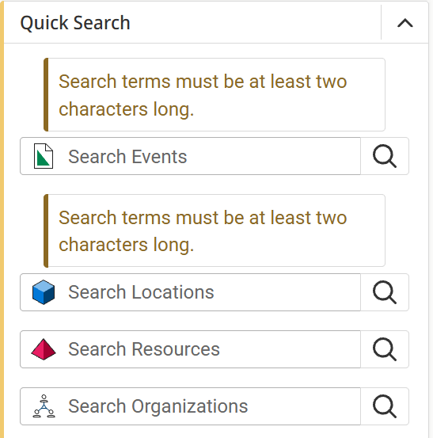
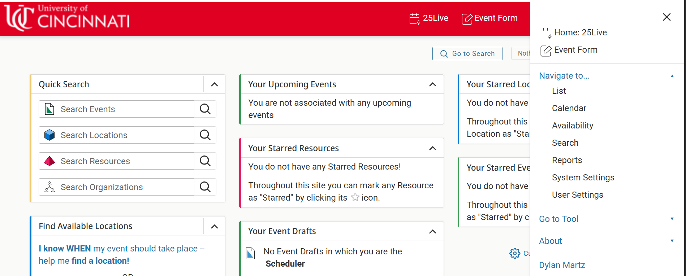

# Redesign

## Overview

This document covers the following topics:
- Initial observation of design flaws
- Observational feedback from various users
- Redesign target
- Redesign decisions
- Redesign feedback

## Redesign Research

### Design Flaws

`Guest View`

Upon entering the 25Live dashboard, a user is considered a guest and is presented with a restricted view of the dashboard screen. As a user of 25Live, I am most likely a student or faculty member of the University of Cincinnati as a user cannot perform any actions within the dashboard without signing in with UC credentials. Once signed in, the user is unable to perform a sign-out action. This makes the guest view obsolete.

`Choice of Icons`

The design choice of the icons representing `Events`, `Organizations`, `Locations`, and `Resources` are poor as they have now universal meaning behind them in a general sense to the user. 

`Dashboard Organization`

Upon entering the dashboard screen, the user is presented with a wide range of unnecesary dropdown menus pertaining to a user's events, resources, etc. The user has the ability to move these dropdown menus around the screen and add/remove dropdown menus to provide customizability. If the design goal was to provide enhanced customization to the user, the designer failed to consider that these options provide increased complexity to what the user should have control of. 

In addition, the menu dropdown in the dashboard provides additional methods of travelling to the same screens that the dashboard menu dropdowns provide. As a result, this design lacks simplicity in providing the shortest path to an option screen from the dashboard.

### User Feedback of Current Design

### Redesign Target

## Redesign Decisions

### User Feedback of New Design