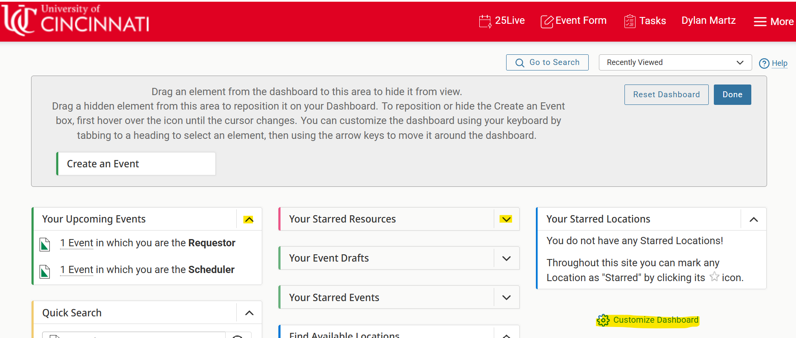
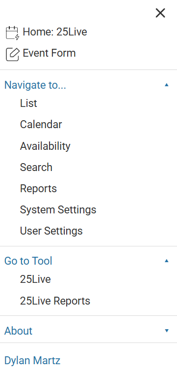
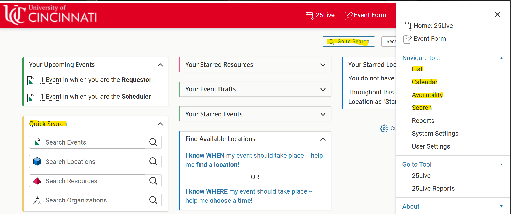

# Redesign

- [Overview](#overview)
- [Initial Design Analysis](#initial-design-analysis)
    - [Design Flaws](#design-flaws)

## Overview

This document covers the following topics:
- Initial observation of design flaws
- User Feedback
- Redesign target
- Redesign decisions
- Redesign feedback

## Initial Design Analysis

### Design Flaws

`Guest View`

Upon entering the 25Live dashboard, a user is considered a guest and is presented with a restricted view of the dashboard screen. As a user of 25Live, I am most likely a student or faculty member of the University of Cincinnati as a user cannot perform any actions within the dashboard without signing in with UC credentials. Once signed in, the user is unable to perform a sign-out action. This renders the guest view obsolete.

`Choice of Icons`

The design choice of the icons representing `Events`, `Organizations`, `Locations`, and `Resources` are poor as they have no universal meaning behind them in a general sense to the user. 

  </img>

`Dashboard Organization`

Upon entering the dashboard screen, the user is presented with a wide range of unnecessary dropdown menus pertaining to a user's events, resources, etc. The user has the ability to move these dropdown menus around the screen and add/remove dropdown menus to provide customizability. If the design goal was to provide enhanced customization to the user, the designer failed to consider that these options come with increased complexity to what the user should have control of. 

  </img>

`Menu Options`

In addition, the menu dropdown in the dashboard presents additional methods of navigating to the same screens that the dashboard menu dropdowns provide. As a result, this design lacks simplicity of its navigational features. For the case of the `Reports` screen, a user is able to travel to that screen using two different buttons from the menu creating redundancy.

  </img>

`Search Options`

Searching 25Live can be done with the following options:
- Click on the `Go to Search` at the top of the dashboard.
- Click on `Search` under the menu
- Click on one of the following menu options for a targeted search
    - `Availability`
    - `Calendar`
    - `List`
- Use the `Quick Search` dropdown

If the goal of these options was to provide enhanced filter methods of searching, this goal is achieved. However, it comes at the expense of simplicity to access these methods.

  </img>

### Observational Study Setup

**Research Goals:**

- Assign users with "challenges" that they must solve by using 25Live
- Diagnose problems with 25Live by observing how users solve the presented challenges and what struggles they encounter
- Document struggles to influence redesign

**User Challenges:**

Each study participant will be observed solving the following 2 challenges:

1. Schedule an event in Langsam 520 for the earliest timeslot available. Once it is scheduled, cancel the booking.
2. Schedule an event for 11/01/2026 at 5 p.m. in any available space. The space must be able to be scheduled without providing a sponsoring organization. (The user does not need to actually schedule the event. Rather, go through the steps as if they were to schedule. This is to prevent reserving a room that someone else may actually need.)

Watch as the user solves these challenges. Have them think aloud and express any problems they encounter or confusion they may have. If the user has never used 25Live before, there will be a learning curve. For example, they may not know where to start, where to find things, etc. Having them express this in real-time will be useful for diagnosing UI learnability issues.

**Potential Issues:**

While solving these challenges, the user may encounter the following problems:

1. Using express scheduler, it may be difficult to find the earliest available timeslot for a location. Challenge 1 may require the user to use the search tab instead.
2. The user may not be able to delete their reservation.
3. For challenge 2, if the user uses the search tab, they may attempt to schedule rooms not available via the express scheduler, which will bring them to the Event Wizard and require a sponsoring organization. They would have to click through rooms 1 by 1 until they find one they can schedule. If they user the express scheduler in the dashboard, this challenge will be easy.

### Observational Study Results

`Interview 1`

**Task 1**
- **1st Attempt**: selected `Events`, searched Langsam 520, attempted to use `Event Forms`
- **2nd Attempt**: searched by `Location`, used `Express Scheduling`, booked 6:30-7pm, confirmed. Went into event details, selected `Cancelled` under the dropdown to cancel the event

**Task 2**
- **1st Attempt**: User knew not to use the `Event Form`, searched Old Chem as a building.
- **2nd Attempt**: Used `Express Scheduling` on dashboard, booked Langsam 414 at 5pm. Cancelled event

`Interview 2`

**Task 1**
- **1st Attempt**: started from browser, searched UC Langsam, launched 25 live through UC website, went to `Locations`, `Availability` in `Search` screen, clicked on room 520, booked room at 6:30 to 7pm. Could not find how to cancel.

**Task 2**
- **1st Attempt**: Went to `Event Forms`, did not have an `organization`
- **2nd Attempt**: Used `Express Scheduling` on `Dashboard`, booked Langsam 602 at 5:00pm

**Notes**: User did not notice that the date was reset to Oct 29th (current day) instead of the required Nov 2nd.

### Survey Questions

- What is your role at UC?
- How often do you use 25Live?
- What do you use 25Live for?
- What are your thoughts on the design of 25Live?
- How easy is it to complete tasks in 25Live?
- How satisfied are you with 25Live?
- What features in 25Live need the most improvement?
- What is the most frustrating part about using 25Live?
- What do you like about using 25Live? 

Survey Link: https://forms.gle/R9xwjFvTYdHHdNV97

### Survey Results

### Expert Heuristic Evaluation

**Jakob Neilsen's 10 Usability Heuristics**

25Live fails the following usability heuristics:
- User Control and Freedom
- Consistency and Standards
- Recognition rather than Recall
- Flexibility and Efficiency of Use
- Aesthetic and Minimalistic Design

### Redesign Target

## Redesign Decisions

### User Feedback of New Design